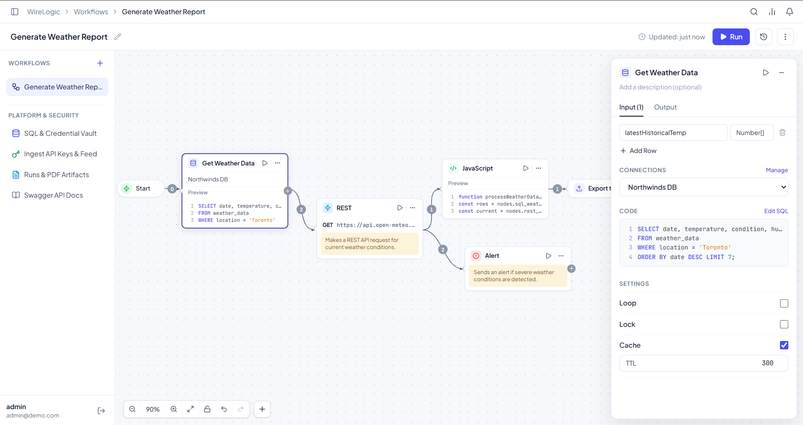
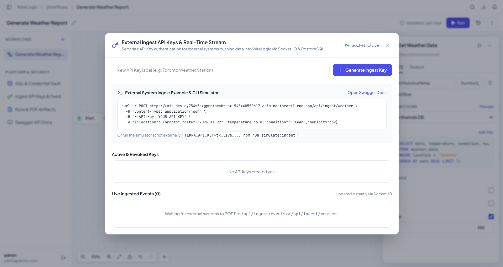
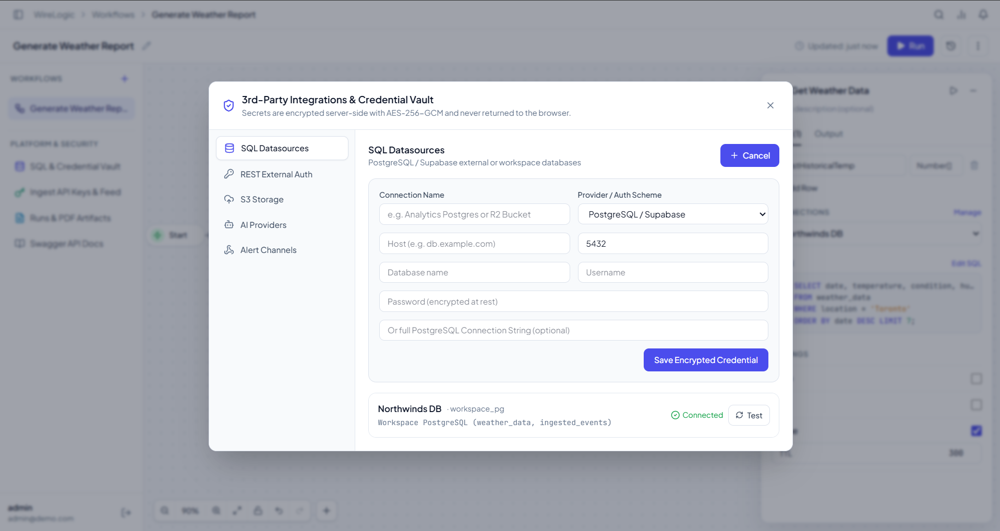
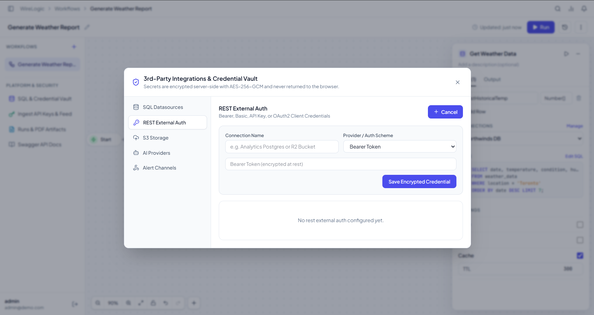
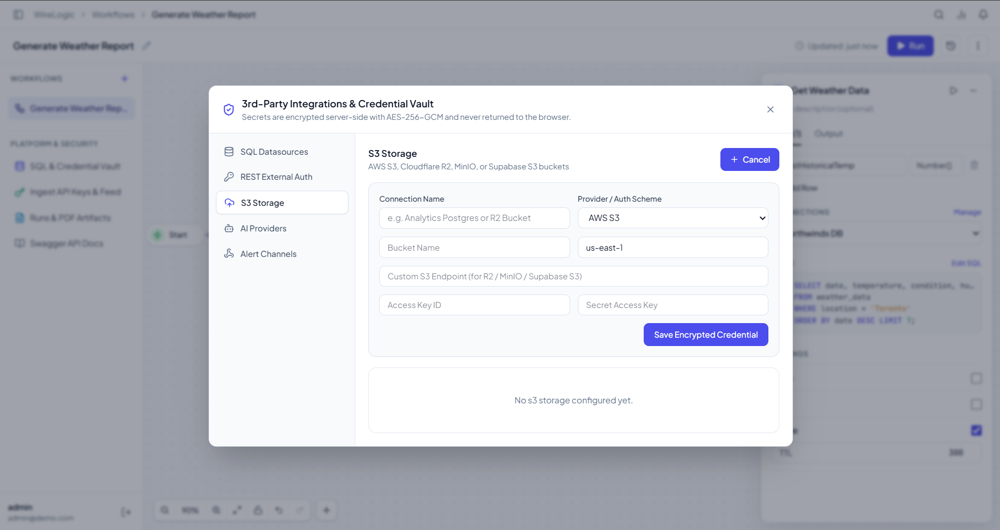
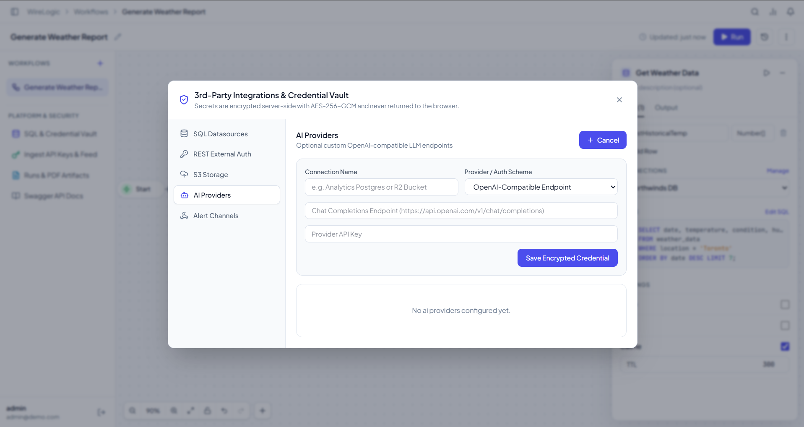
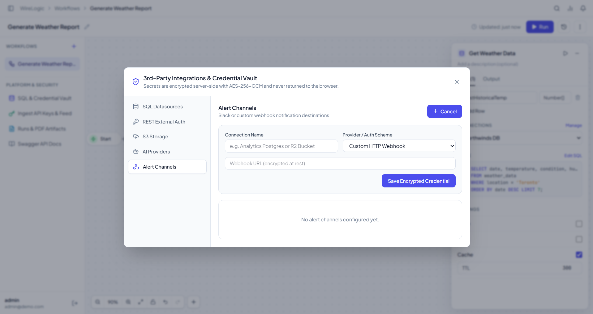
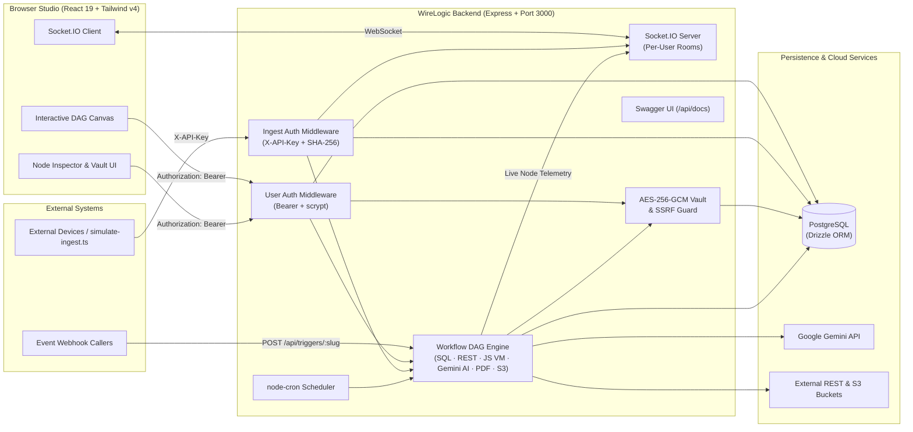

<div align="center">

# WireLogic

**Visual Data Orchestration & Workflow Automation Studio**

Unite PostgreSQL queries, authenticated REST APIs, sandboxed JavaScript transforms, AI/LLM reasoning, real-time WebSocket ingestion, and automated PDF/S3 exports on a single interactive canvas.

[](https://react.dev/)
[](https://www.typescriptlang.org/)
[](https://expressjs.com/)
[](https://socket.io/)
[](https://orm.drizzle.team/)
[](https://ai.google.dev/)
[](/api/docs)
[](#system-architecture)

</div>

---

## Interface & Visual Tour

<p align="center">
  
</p>

<table>
  <tr>
    <td width="33.3%" align="center" valign="top">
      
      <br />
      <sub><strong>External Ingest API &amp; Socket.IO Stream</strong><br />Dedicated <code>X-API-Key</code> auth &amp; live event feed</sub>
    </td>
    <td width="33.3%" align="center" valign="top">
      
      <br />
      <sub><strong>SQL Datasources Vault</strong><br />PostgreSQL / Supabase connections &amp; live test</sub>
    </td>
    <td width="33.3%" align="center" valign="top">
      
      <br />
      <sub><strong>REST External Auth Vault</strong><br />Bearer, Basic, API Key &amp; OAuth2 Client Credentials</sub>
    </td>
  </tr>
  <tr>
    <td width="33.3%" align="center" valign="top">
      
      <br />
      <sub><strong>S3-Compatible Storage Vault</strong><br />AWS S3, Cloudflare R2 &amp; MinIO bucket targets</sub>
    </td>
    <td width="33.3%" align="center" valign="top">
      
      <br />
      <sub><strong>AI / LLM Providers</strong><br />Built-in Gemini &amp; custom OpenAI-compatible endpoints</sub>
    </td>
    <td width="33.3%" align="center" valign="top">
      
      <br />
      <sub><strong>Alert Channels Vault</strong><br />Encrypted Slack &amp; custom HTTP webhook dispatchers</sub>
    </td>
  </tr>
</table>

---

## Project Structure

```text
wirelogic/
├── docs/                              # Documentation screenshots & media assets
│   ├── screen_capture_main.png
│   └── screen_capture_{2..7}.png
├── scripts/
│   └── simulate-ingest.ts             # External system HTTP ingest simulator (uses X-API-Key)
├── src/
│   ├── components/
│   │   ├── AuthView.tsx               # Workspace sign-in & account provisioning UI
│   │   ├── CredentialsVaultModal.tsx  # Encrypted SQL, REST Auth, S3, AI & Alert vault manager
│   │   ├── ExecutionsDrawer.tsx       # Run history, PDF/S3 artifacts & Chat Trigger console
│   │   ├── FunctionPicker.tsx         # Categorized "Search Functions" node picker popover
│   │   ├── IngestApiPanel.tsx         # API Key management & live Socket.IO event viewer
│   │   ├── NodeInspector.tsx          # Floating node config, Start trigger modes & output tab
│   │   ├── NodeMeta.tsx               # Node icon badges, catalog & default config factory
│   │   ├── SyntaxCodeBlock.tsx        # Line-numbered SQL & JavaScript syntax preview
│   │   └── WorkflowCanvas.tsx         # Interactive pan/zoom DAG canvas with bezier edges
│   ├── db/
│   │   ├── index.ts                   # PostgreSQL pg.Pool (split PG* env vars) & Drizzle client
│   │   └── schema.ts                  # Drizzle ORM tables (users, workflows, vault, ingest, etc.)
│   ├── lib/
│   │   └── api.ts                     # In-memory Bearer fetch wrapper & Socket.IO client
│   ├── server/
│   │   ├── auth.ts                    # Separated User Bearer middleware, API Key middleware & SSRF guard
│   │   ├── crypto.ts                  # scrypt password hashing, SHA-256 tokens & AES-256-GCM vault
│   │   ├── defaultWorkflow.ts         # Starter "Northwinds DB" & "Generate Weather Report" seeder
│   │   ├── engine.ts                  # DAG execution engine (SQL, REST, JS vm, Gemini AI, PDF, S3)
│   │   ├── scheduler.ts               # node-cron scheduler for time-triggered workflows
│   │   └── swagger.ts                 # OpenAPI 3.0 spec & Swagger UI setup (/api/docs)
│   ├── shared/
│   │   └── types.ts                   # Shared TypeScript domain contracts
│   ├── App.tsx                        # Main WireLogic workspace shell & real-time state sync
│   ├── index.css                      # Tailwind CSS v4 & dot-grid canvas tokens
│   └── main.tsx                       # React 19 entry point
├── server.ts                          # Express + Socket.IO + Vite middleware server (port 3000)
├── drizzle.config.ts                  # Drizzle Kit PostgreSQL configuration
├── vite.config.ts                     # Vite build & asset bundling configuration
├── package.json
└── .env.example                       # Environment variable template
```

---

## System Architecture

WireLogic separates user-facing studio operations, external machine-to-machine ingestion, and encrypted credential execution across distinct security boundaries:



### Key Architectural Guarantees

1. **Separated Authentication Planes**:
   - **App Auth (`/api/auth/*`, `/api/workflows/*`, `/api/credentials/*`)**: Email/password registration and login hashed with `crypto.scrypt` + `timingSafeEqual`; opaque session tokens hashed (`SHA-256`) in PostgreSQL and kept strictly in client memory (`Authorization: Bearer`).
   - **External Ingest Auth (`/api/ingest/events`, `/api/ingest/batch`, `/api/ingest/weather`)**: Dedicated `X-API-Key` header authentication backed by hashed API keys (`api_keys` table) with scope tracking and instant revocation.
2. **AES-256-GCM Credential Vault**:
   - Third-party secrets (external PostgreSQL passwords/connection strings, REST Bearer/Basic/OAuth2 secrets, S3 secret access keys, custom AI API keys, and alert webhook URLs) are encrypted server-side using `VAULT_ENCRYPTION_KEY` before storage and never returned in plaintext to the browser.
3. **Multi-Scenario `Start` Triggers**:
   - **Manual**: On-demand execution from the canvas or API with custom JSON payloads.
   - **Scheduled (`node-cron`)**: Automatic background execution on standard 5-field cron expressions.
   - **On Event Hit (`POST /api/triggers/:slug`)**: Dedicated webhook URLs for external event-driven orchestration.
   - **On Chat Start**: Interactive chat runner injecting user prompts directly into the workflow pipeline.
   - **On Data Ingest**: Automatically triggers matching workflows whenever external telemetry arrives on the Ingest API.
4. **Real-Time Synchronization**:
   - Socket.IO broadcasts live ingested payloads (`ingest:received`), node-by-node execution states (`execution:node:running`, `execution:node:completed`, `execution:node:error`), and alert triggers (`alert:triggered`) instantaneously to authenticated browser sessions.

---

## Tech Stack

| Layer | Technologies |
| :--- | :--- |
| **Frontend** | React 19, TypeScript, Tailwind CSS v4, Lucide Icons, Motion, Socket.IO Client |
| **Backend & Real-Time** | Node.js, Express 4, Socket.IO 4, `node-cron`, `node:vm` JS Sandbox, Zod |
| **Database & ORM** | PostgreSQL (Supabase / Standard Postgres), `pg`, Drizzle ORM, Drizzle Kit |
| **AI, Docs & Exports** | `@google/genai` (`gemini-4-hydrogen`), `pdfkit`, `@aws-sdk/client-s3`, `swagger-ui-express` |
| **Tooling & Bundler** | Vite 8, `tsx`, ESBuild |

---

## How to Build

### 1. Prerequisites
- **Node.js** `>= 20` (recommended `v22+`)
- A **PostgreSQL** database (e.g., Supabase Pooler or local PostgreSQL)
- A **Google Gemini API Key** for built-in AI/LLM workflow nodes

### 2. Install Dependencies
```bash
npm install
```

### 3. Configure Environment Variables
Copy `.env.example` to `.env` and fill in your split PostgreSQL credentials and encryption key:

```env
GEMINI_API_KEY="your_gemini_api_key"
APP_URL="http://localhost:3000"

PGHOST="aws-1-ap-northeast-1.pooler.supabase.com"
PGPORT="5432"
PGDATABASE="postgres"
PGUSER="postgres.your_project_ref"
PGPASSWORD="your_postgres_password"
PGSSL="require"

# 64-char hex key (32 bytes) for AES-256-GCM Credential Vault
VAULT_ENCRYPTION_KEY="your_64_char_hex_key"
```

> **Tip**: Generate a 32-byte hex key with `node -e "console.log(require('crypto').randomBytes(32).toString('hex'))"`.

### 4. Run in Development
```bash
npm run dev
```
The Express + Socket.IO + Vite middleware server starts on **`http://localhost:3000`**, automatically initializes the PostgreSQL schema if absent, and exposes Swagger UI at **`http://localhost:3000/api/docs`**.

### 5. Typecheck & Production Build
```bash
npm run lint    # Runs tsc --noEmit
npm run build   # Builds React SPA into dist/ and bundles server into dist/server.mjs
```

### 6. Simulate External Data Ingestion (Optional)
Create an Ingest API Key inside **WireLogic → Ingest API Keys & Feed**, then push sample weather & heartbeat telemetry through the real `/api/ingest/*` endpoints:

```bash
TEKNA_API_KEY=tk_live_your_generated_key npm run simulate:ingest
```

---

## How to Deploy

### Standard Node.js / Container Deployment (Cloud Run, Railway, Fly.io, VPS)

1. **Build the frontend bundle**:
   ```bash
   npm ci
   npm run build
   ```
2. **Set runtime environment variables** in your hosting platform's secrets manager:
   - `NODE_ENV=production`
   - `PORT=3000` (or platform-assigned `PORT`)
   - `PGHOST`, `PGPORT`, `PGDATABASE`, `PGUSER`, `PGPASSWORD`, `PGSSL=require`
   - `VAULT_ENCRYPTION_KEY` (persist across restarts so encrypted Vault credentials remain readable)
   - `GEMINI_API_KEY`
   - `APP_URL` (your public HTTPS URL)
3. **Start the production server**:
   ```bash
   npm start
   ```
   *(Executes `node dist/server.mjs`, serving the compiled `dist/` SPA alongside all `/api/*` REST endpoints, `/api/docs` Swagger UI, and Socket.IO WebSockets on the same port.)*

### Reverse Proxy & WebSocket Notes
- Ensure your reverse proxy (Nginx, Cloudflare, Cloud Run) forwards `Upgrade` and `Connection` headers for `/socket.io/*` WebSocket upgrades.
- `app.set('trust proxy', 1)` is enabled in `server.ts` for accurate HTTPS proxy handling.
